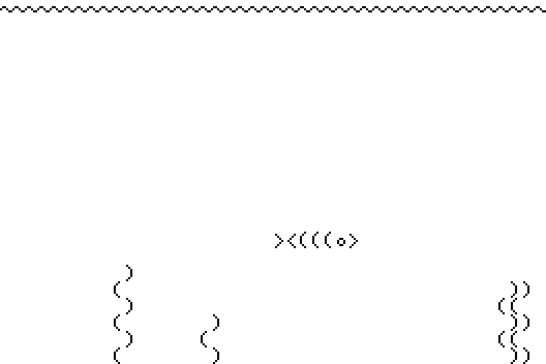
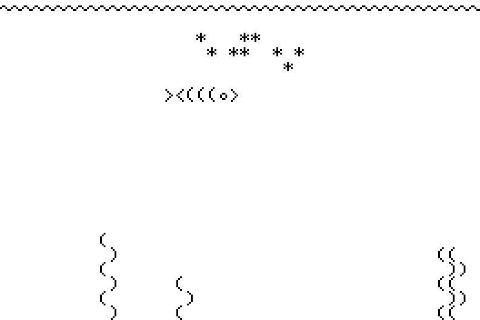
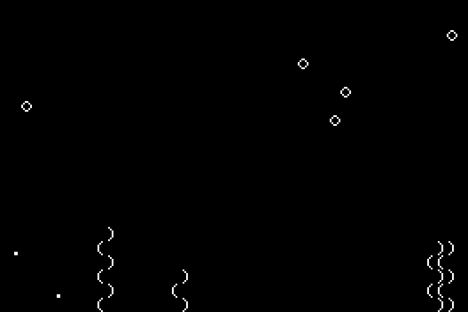

# go-asciiquarium

A tiny virtual aquarium for the [Pimoroni Badger 2350](https://shop.pimoroni.com/products/badger-2350),
an e-ink badge with a battery, written in Go for [TinyGo](https://tinygo.org).

The tank is ASCII art: a line of waves on top, algae at the bottom, and one fish,
`<o)))><`, that turns around by flipping to its mirror image `><(((o>`. Bubbles rise
from the algae all the time, a few at once, and pop at the surface.

The badge sleeps, and every minute it wakes up, lets the tank live for that long,
and shows it: the fish is somewhere else, the algae has swayed. Press button A and
5 to 10 pellets (`*`) drop from the middle of the tank, each at its own speed. The
fish swims to the closest one and eats whatever it touches; pellets that reach the
bottom stay there for it to eat. The screen refreshes as fast as it can while that
goes on and for half a minute more, and then it is back to one picture a minute.
At night, say from 22:00 to 07:00 by the badge's clock, the tank sleeps: the fish
is gone, the picture is the negative of the day's, and there is only one every ten
minutes, of the algae and the bubbles slowly rising from it; see [Night](#night).
Press the button then and the tank shows the day for half a minute, and goes back to
sleep. All these times are settings, not fixed.

## What it looks like

These are the exact pixels the badge's screen gets, drawn by `make snapshot`.

**By day**, the fish swims about and a steady stream of bubbles rises from the algae.



**Feeding**: press button A and pellets sink from the middle of the tank; the fish
turns and goes for the nearest one.



**At night** the fish is gone, the picture is in negative, and only the algae and the
bubbles slowly rising from it are left.



It also runs on a computer, for debugging, with exactly the same logic, in real
time.

> **Status: untested on a badge.** Everything that can be checked without one
> is: the tests pass, also with TinyGo's compiler and runtime, and the firmware
> builds. But the display driver and the pin wiring have never run on real
> hardware. Read [First flash](#first-flash) before you trust it.

## Try it on your computer

```sh
make run                          # real time; f feeds, n/d skip the clock to night/day, r new tank, q quits
make run ARGS="-seed 42"          # the same seed always gives the same tank
make run ARGS="-time 21:59:50"    # the clock says what you want: watch it fall asleep
make run-badge                    # at the badge's pace, with its slow e-ink screen simulated
make run-badge ARGS="-refresh 0"  # ... without simulating the slow refresh
make run-badge ARGS="-idle 3s -tail 5s -night-interval 5s"   # a faster pace, to watch it without waiting
make snapshot ARGS="-feed -steps 1"   # draw the badge's screen to bin/snapshot.png
make snapshot ARGS="-asleep -steps 40"  # ... as it is at night, 40 pictures in
```

`make run` shows the 44x22 grid of characters in real time: a step of the animation
every tenth of a second, which is how the scene is made to be seen, so it is the way
to check that the fish, the bubbles, the feeding and the night work. The badge can't
do that, because its screen takes about a second to refresh; it shows a picture every
few steps instead, and `make run-badge` shows exactly that, at the badge's pace
(`-idle`, `-tail` and `-night-interval` change it). Its status line says which phase
it is in, and what the badge's screen would do: pictures shown, pictures skipped
because nothing had changed, cleanings, and refreshes. `make snapshot` draws the real
264x176 pixels as the badge would, in black and white.

## Build it for the badge

You need [Go](https://go.dev/dl/) and [TinyGo](https://tinygo.org/getting-started/install/)
(0.44.0 was used, with Go 1.27). TinyGo is one command:

```sh
make install-dependencies    # or: make install
```

It downloads TinyGo 0.44.0 for your computer (macOS or Linux, Intel or ARM) into `.tools/`
in this folder, checks the download against its published SHA-256, and unpacks it. It
needs no `sudo` and changes nothing else on the computer; delete `.tools/` to remove it.
From then on `make` uses that copy by itself, so there is no `PATH` to set up.

```sh
make badger       # bin/aquarium.uf2
make flash        # build and copy it to the badge
make size         # about 100 KB of flash and 15 KB of RAM
make check        # vet, test, build the firmware, test with TinyGo
```

To use a TinyGo of your own, put it on your `PATH` or say where it is:
`make badger TINYGO=/path/to/tinygo`. The one in `.tools/` wins if it is there.

The times are settings of the firmware, and `make` takes them for the badge:

```sh
make flash IDLE=2m NIGHT=23:00-06:30 NIGHT_INTERVAL=5m NIGHT_PEEK=1m TAIL=45s
```

The build also stamps the firmware with the time it was built. That is how the
badge's clock gets its time: see [The clock](#the-clock).

To flash, put the badge in boot mode: Pimoroni's README names a BOOT button (far
left on the back) and a RESET button next to it. Hold BOOT, tap RESET, and a drive
appears; `make flash` copies the firmware to it, or drag `bin/aquarium.uf2` there
yourself. Check [Pimoroni's page](https://shop.pimoroni.com/products/badger-2350)
if that is not how your badge does it.

## This replaces the badge's firmware

This is the firmware of the badge, not an app for it. Pimoroni's launcher and its apps
are MicroPython: an app is a folder with an `__init__.py` and an icon that you copy to
the badge's `apps` directory, and they run on Pimoroni's MicroPython firmware. A Go
program built by TinyGo is native code and can't be one of them. Flashing it replaces
Pimoroni's firmware, so the badge boots straight into the aquarium and there is no
launcher or menu.

- **Your apps are probably safe.** Pimoroni says their plain firmware image "will
  replace only the firmware" and keep your apps, so the two live apart in the flash.
  This firmware is about 100 KB and Pimoroni's is several MB. That is not tested here:
  to be sure, copy your apps off first (double-tap RESET and a drive called Badger2350
  appears; copy its `apps` folder).
- **Getting back to Pimoroni's firmware.** Hold BOOT (far left on the back) and tap RESET,
  and a drive called RP2350 appears: that mode is in the chip's own ROM, so no firmware
  can take it away. Drop `badger-v3.1.1-micropython.uf2` from
  [Pimoroni's releases](https://github.com/pimoroni/badger2350/releases/latest) on it to
  get the launcher back with your apps; the `-with-filesystem` image resets the apps to
  the defaults.
- **Without their firmware** you also lose what comes with it: the launcher, the drive
  mode on a double tap of RESET (to flash again, use BOOT and RESET), their Wi-Fi time
  setting, and their deep sleep, which TinyGo can't use.

## How it works

| path | what |
| --- | --- |
| `cmd/badger` | the firmware: pins, SPI, the button, and the main loop (TinyGo only) |
| `cmd/aquarium` | the same thing on a computer: terminal, simulated screen, PNG snapshots |
| `internal/app` | what both run: the tank and the loop that gives it its pace |
| `internal/aquarium` | the scene: surface, algae, bubbles, fish, food |
| `internal/flip` | which characters turn into each other when mirrored (`<` and `>`...), used by the fish and by the font |
| `internal/anim` | a small ASCII animation engine (a port of the part of Perl's `Term::Animation` the original aquarium used) |
| `internal/button` | a push button: remembers a press until asked, and debounces it |
| `internal/epd` | the e-ink side: a 1-bit frame, the font, the SSD1680 driver, and when to clean |

**Drawing.** The scene is a grid of characters, 44 columns by 22 rows. Each
character is drawn as a 6x8 pixel glyph from a small built-in font
(`internal/epd/font.go`). The glyphs are bitmaps of those ASCII characters, so
the picture is the ASCII art, not a different style.

**Changing the fish.** It is one string, `fishFacingLeft` in `internal/aquarium/fish.go`;
the other way round is computed by mirroring it (`<>()[]{}/\` turn around), and its
width is whatever the string is, nowhere written down. The
font has the characters the scene draws and the brackets a fish can be made of
(`<>()[]{}`). A fish made of anything else would show as an empty box on the
badge: `make test` fails in that case and names the missing characters. Add them to
`internal/epd/font.go`.

Characters that turn into each other when mirrored are listed once, in
`internal/flip` (`<>`, `()`, `[]`, `{}`). The font draws only the first of each
pair; the second is computed as its mirror image, so it can never disagree with
it. To add a pair, add it to `flip.Pairs` and draw its first character.

**Pace.** `app.Run` is the loop, and the badge and the computer both run it; each
only says what time it is and how to wait for "up to this long, or until the button
is pressed" (`app.Env`). It has two speeds:

- *Idle*: every `Idle` (a minute) the tank is let live for that long, as much as it
  would in the real world, and shown. The fish ends up somewhere else, the algae
  sways, and a stalk that is old enough dies and grows back somewhere new.
- *Burst*: after a press, and while there is food in the tank, pictures come back to
  back, as fast as the screen refreshes. Each moves the tank on by 6 steps of a
  tenth of a second (`app.StepsPerUpdate`). After the last pellet is eaten it goes
  on for `Tail` (30 s) more, then shows one last picture (the screen cleans itself
  then if it needs to) and goes back to idle. Feeding again extends it.

A picture identical to what is on the screen is not sent at all. A feeding takes
only a few pictures with food in the tank, since the fish is fast and the pellets
start close together; the rest of the burst is the tail.

**Ghosting.** A fast e-ink refresh leaves a faint trace of the previous picture.
The display counts the pictures it has shown and, every 10 (`epd.Config.CleanEvery`),
flashes the screen black and white to clean it. It also cleans at the end of a
feeding (`SettleMin`), so the picture that stays on the screen for hours is a clean
one. At power-up it cleans first, as nobody knows what was there before. Cleaning
uses the same waveform as drawing, so no new waveform is involved.

**Sleep.** Between pictures the badge polls button A every 20 ms and the processor
idles in between. That is *light* sleep: RAM is kept, so the tank is where it was,
and waking is instant. The wake-up for the next picture is just a timer of the chip,
so the real-time clock is not needed for it. The battery drain of this has not been
measured.

The badge also has a real-time clock chip, a PCF85063A on the I2C bus (GPIO 4 and 5,
address 0x51, powered through `POWER_EN`). It keeps the date and time on a crystal of
its own, and tells the tank when night begins and ends: see [The clock](#the-clock).
It could also pull its INT line low (wired to GPIO 13) at a set time, after a
countdown, or every half minute, to wake the main chip from its deep sleep, as the
main chip's own always-on timer can, which is what Pimoroni's timed sleep uses. That
deep sleep draws far less (about 167 µA, by one user's measurement on the Pimoroni
forum) but TinyGo has no support for it, and waking from it is a reboot that loses
the tank. It is the obvious next step if the battery does not last (see below).

**Pictures per day.** One a minute is 1,440 a day, about half a million a year, plus
the black-and-white flashes of the cleanings (every 10 pictures). Check what the
panel is rated for, and the battery life, before settling on `Idle`.

## Night

Between two times of day, by default 22:00 to 07:00, the tank sleeps. The night can go
through midnight, as this one does, or fall inside a day (01:00-05:00).

- **Going to sleep.** At the first look after the night begins the tank shows one last
  picture, so that the screen is clean for the night, and goes to sleep.
- **The picture at night** is the *negative* of the day's: white on black. The fish is
  gone, and so are the water surface and the food. What is left is the algae, swaying,
  and bubbles that start above a stalk of it now and then and rise.
- **Slowly.** There is one picture every `Interval` (ten minutes). In each the algae
  has swayed once and every bubble has risen one row, and grown a little, to be full
  size at the top, where it leaves. A bubble takes about three hours to rise from the
  algae to the top.
- **Waking up.** When the night ends, to the second, the tank shows the day again, with
  a fish somewhere in the water.
- **The button** is a peek at the day: the tank wakes up and shows one picture of
  itself by day, with a fish somewhere in the water, for `Peek` (half a minute, the
  setting `NIGHT_PEEK`), and then goes back to sleep. Nobody can feed the fish at night:
  that would be dozens of refreshes of the screen and the battery, and a peek is two. A
  press during the peek does nothing. With `NIGHT_PEEK=0s` the button does nothing at
  night.

Without a time on the clock the tank never sleeps.

### The clock

The badge has a real-time clock, which keeps the time on a crystal of its own while
everything else sleeps. It is not set to anything out of the box, and it has no way to
find out: the firmware has no Wi-Fi. So `make` stamps the firmware with the time of the
build, on the wall of the computer, and at start-up the badge sets its clock to it if
the clock lost its power (it says so itself) or is behind. In practice: flash the
badge, and it knows the time to within a few minutes.

Things to know: the time is *local time*, with no time zone and no summer time, so
reflash when the clocks change; like any crystal clock it drifts, by a few seconds a
month, so reflash now and then too; and a badge flashed without `make` has no time to
set. The registers and the way to set the clock are those of the chip's datasheet, as
the Linux kernel's driver uses them (`internal/rtc`).

## First flash

Things that follow Pimoroni's firmware but that nobody has run from Go. If the
screen stays blank or shows rubbish, look here first.

- **Power pin.** `POWER_EN` (GPIO 27) is driven high at start-up, as Pimoroni's
  firmware does. Its header calls it "I2C power for the RTC"; TinyGo's board file
  guessed it powers the display. If the screen stays blank, this is a suspect.
- **BUSY.** The screen's BUSY pin (GPIO 16) is read as *high means busy*, as in
  Pimoroni's driver. SPI is set up without a receive pin because GPIO 16 is both.
- **Buttons.** Pulled up and read as pressed when *low*, as in Pimoroni's init.
- **Orientation.** The picture's top left is the badge's top left, as in
  Pimoroni's framebuffer. If it is upside down or mirrored, the data entry mode
  (`regEntryMode` in `internal/epd/driver.go`) is the place.
- **Timing.** SPI runs at 4 MHz, mode 0. Refreshes should take about a second.
  How often to clean (`CleanEvery`, `SettleMin`) and how many steps go into a
  picture (`StepsPerUpdate`) are guesses to tune by eye.
- **The clock.** It is read and set over I2C0 at 400 kHz after `POWER_EN` has been
  high for half a second, as Pimoroni's firmware does it, and nobody has run it from
  Go. If the badge never sleeps at night, the clock could not be read: a message
  on the serial port says so.
- **Button during a refresh.** The button is looked at every 5 ms while the screen
  is busy, and a press is remembered until the main loop asks, so a tap during a
  refresh counts, and is acted on when the picture is done. It is debounced
  (`internal/button`). Whether the contacts of the real button need a longer
  `Debounce` is for the badge to say.

## Not done yet

- **Partial refresh**, to update faster than once a second. Pimoroni's driver has
  none, so the waveform has to be worked out on the real panel.
- **Deep sleep**, woken by the main chip's timer or by the real-time clock, with the
  tank saved across the reboot.
- **Setting the clock** from something better than the build time (Wi-Fi, or the
  buttons).
- **Showing the time**, from the real-time clock.
- The other four buttons, the LEDs on the back, the battery gauge.

## Conventions

No magic numbers: a number that means something has a name and a comment where it
is defined (`algaeMinHeight`, `bubblePercent`, `lutSize`, `spiFrequency`...), and
nothing is written down twice if it can be worked out from something else, like the
fish's width from the fish. Only 0, 1, "half" and the "+1" of a count are left bare.

## Tests

```sh
make test         # about 5 s
make test-tinygo  # the same tests with TinyGo's compiler and runtime
```

The display driver is tested against a recording transport: the exact sequence
of commands, the layout and polarity of the pixels, the waveform, and the rules
for skipping and cleaning. The scene runs for the equivalent of 10 minutes on
grids from 200x60 down to 5x2, checking that nothing panics and nothing is drawn
outside the grid.

## Credits and license

The algae, the bubbles and the animation engine come from
[asciiquarium](http://robobunny.com/projects/asciiquarium) by Kirk Baucom
([source](https://github.com/cmatsuoka/asciiquarium)). This is a derivative work
and is distributed under the same terms, the GNU General Public License,
version 2 or (at your option) any later version. See [LICENSE](LICENSE).

The display driver is transcribed from Pimoroni's Badger 2350 firmware (MIT). See
[THIRD_PARTY_NOTICES.md](THIRD_PARTY_NOTICES.md).
